<h1 align="center">RV32I Pipelined Processor with an L1 Memory Hierarchy</h1>

<p align="center">
A five-stage pipelined RISC-V (RV32I) processor with dynamic branch prediction and split L1
instruction and data caches, written in SystemVerilog, checked instruction-by-instruction against the official reference
simulator, and synthesised for an AMD/Xilinx Zynq UltraScale+ FPGA.
</p>

<p align="center">
  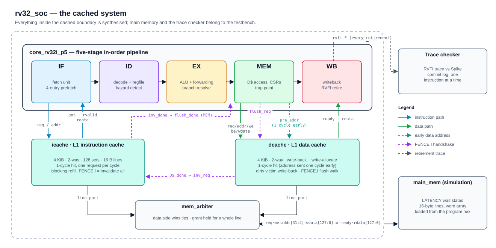
</p>

| | |
|---|---|
| **ISA** | RV32I base integer ISA, Zicsr, Zicntr, Zifencei; machine mode with precise traps |
| **Core** | 5-stage in-order pipeline (IF · ID · EX · MEM · WB), full forwarding, decoupled fetch with a 4-entry prefetch buffer |
| **Branch prediction** | 64-entry branch target buffer + 256-entry bimodal predictor (2-bit counters), predicted in IF, checked in EX; 99.4% accurate on a 32,000-instruction workload |
| **Caches** | 4 KiB L1 I-cache + 4 KiB L1 D-cache, 2-way set-associative, 16-byte lines, LRU, write-back + write-allocate data cache, 1-cycle hits |
| **FPGA** | XCK26 (Kria K26 / KV260): cached system **213.5 MHz** (6,788 LUTs, 4,604 flip-flops, 10 block RAMs, 0 DSPs); pipeline alone 264.4 MHz (post-synthesis) |
| **Verification** | Matches the Spike reference simulator instruction-for-instruction; 54/58 riscv-tests on every design, including runs with up to 10 memory wait states; 16 self-checking unit testbenches |
| **Performance** | Branch prediction: pipeline IPC on `hello.c` 0.61 → 0.78 and 0.98 on the stress test. Caches: 1.53× fewer cycles than the uncached pipeline on `hello.c` at 10 wait states |
| **Language / tools** | SystemVerilog · Verilator 5.026 · Spike 1.1.0 · GCC 13.2.0 · Vivado 2022.2 · Docker |

---

## Contents

1. [Quick start](#1-quick-start)
2. [What is in this repository](#2-what-is-in-this-repository)
3. [The instruction set implemented](#3-the-instruction-set-implemented)
4. [The pipeline, stage by stage](#4-the-pipeline-stage-by-stage)
   - [4.1 IF — the decoupled fetch unit](#41-if--the-decoupled-fetch-unit)
   - [4.2 ID — decode, register read, hazard detection](#42-id--decode-register-read-hazard-detection)
   - [4.3 EX — forwarding, ALU, branches, addresses](#43-ex--forwarding-alu-branches-addresses)
   - [4.4 MEM — data access, CSRs, the trap point](#44-mem--data-access-csrs-the-trap-point)
   - [4.5 WB — writeback and retirement](#45-wb--writeback-and-retirement)
   - [4.6 Hazards, stalls and flushes](#46-hazards-stalls-and-flushes)
   - [4.7 Traps and the CSR file](#47-traps-and-the-csr-file)
   - [4.8 Branch prediction](#48-branch-prediction)
5. [The memory hierarchy](#5-the-memory-hierarchy)
   - [5.1 Cache organisation](#51-cache-organisation)
   - [5.2 The block-RAM template](#52-the-block-ram-template)
   - [5.3 The instruction cache](#53-the-instruction-cache)
   - [5.4 The data cache](#54-the-data-cache)
   - [5.5 Arbiter, line port and main memory](#55-arbiter-line-port-and-main-memory)
   - [5.6 FENCE.I, end to end](#56-fencei-end-to-end)
6. [The single-cycle baseline](#6-the-single-cycle-baseline)
7. [The verification ecosystem](#7-the-verification-ecosystem)
8. [Results](#8-results)
9. [Design decisions and trade-offs](#9-design-decisions-and-trade-offs)
10. [Bugs the verification flow caught](#10-bugs-the-verification-flow-caught)
11. [Limitations and roadmap](#11-limitations-and-roadmap)
12. [Repository layout and make targets](#12-repository-layout-and-make-targets)
13. [References](#13-references)

---

## 1. Quick start

Everything runs from WSL2 inside a pinned Docker image, driven by `make` from the repository root.

```bash
make env-check                 # host prerequisites (docker, python, vivado reachable)
make docker-build              # build the pinned toolchain image (~20 min, once)
make tools-check               # prove every tool runs, and that none has drifted

make lint                      # Verilator -Wall on every top; any warning fails
make tb TB=tb_dcache           # one self-checking unit testbench
make cosim PROG=hello CORE_TB=tb_soc          # cached system vs Spike, one program
make cosim-lat PROG=cachestress CORE_TB=tb_soc LAT=10   # with 10 wait states
make fetch-tests               # clone riscv-tests (once)
make regress CORE_TB=tb_soc    # the official compliance suite, against Spike
make synth CORE=rv32_soc TARGET=3.5           # Vivado: Fmax, area, loop + BRAM gates
make results                   # regenerate results/comparison.md
```

`CORE_TB` selects the design under test: `tb_core_rv32i` (single-cycle), `tb_core_p5`
(pipeline, ideal memory), `tb_core_p5_lat` (pipeline with memory latency), `tb_soc`
(pipeline + caches). The checks are identical for all of them — see
[section 7](#7-the-verification-ecosystem).

To regenerate every figure in this README: `python scripts/make_diagrams.py`.

---

## 2. What is in this repository

Three processors share one ISA package, one set of building blocks and one verification flow:

| Design | Top module | What it is for |
|---|---|---|
| **Cached system** | `rv32_soc` | The main design: the pipeline plus L1 I-cache, L1 D-cache and a memory arbiter, with one line-wide port to main memory |
| **Pipeline** | `core_rv32i_p5` | The five-stage core on its own, connected straight to a memory model; used for uncached comparisons |
| **Single-cycle** | `core_rv32i` | The reference point: every instruction completes in one clock |

Each design emits the same **RVFI retirement trace** (one record per instruction that
completes), which is what the verification flow compares against the reference simulator.
That shared interface is why a new microarchitecture can be dropped in and checked by the
existing flow without changing a line of it.

```
rtl/common   rv32_pkg (ISA constants)  alu  regfile  decoder  csr_file
rtl/core     core_rv32i  core_rv32i_p5  fetch_unit  branch_predictor
rtl/mem      sram_1r1w  icache  dcache  mem_arbiter  main_mem*  latency_mem*  magic_mem*
rtl/soc      rv32_soc                                   (* = simulation-only models)
```

---

## 3. The instruction set implemented

### Instructions

| Group | Instructions |
|---|---|
| Arithmetic / logic | `ADD SUB SLL SLT SLTU XOR SRL SRA OR AND` and the immediate forms `ADDI SLTI SLTIU XORI ORI ANDI SLLI SRLI SRAI` |
| Upper immediates | `LUI AUIPC` |
| Control flow | `JAL JALR BEQ BNE BLT BGE BLTU BGEU` |
| Loads / stores | `LB LH LW LBU LHU SB SH SW` |
| System | `ECALL EBREAK MRET`, `FENCE` (a no-op on one hart with blocking caches), `FENCE.I` (flushes the data cache, invalidates the instruction cache) |
| CSR (Zicsr) | `CSRRW CSRRS CSRRC CSRRWI CSRRSI CSRRCI` |

Any other encoding — an unknown opcode, a reserved `funct3`, a non-zero `funct7` where one is
not allowed, including the M extension's `MUL`/`DIV` — raises an **illegal-instruction
exception** rather than doing something undefined.

### Control and status registers

| CSR | Behaviour |
|---|---|
| `mstatus` | `MIE`/`MPIE` are pushed on a trap and popped on `mret`; `MPP` always reads `11` (machine mode is the only mode) |
| `mtvec` | Direct mode; the low two bits are forced to zero |
| `mepc`, `mcause`, `mtval` | Written by trap entry; software-writable (`mepc[0]` forced to zero) |
| `mscratch`, `mie`, `mip` | Read/write storage (no interrupt sources exist yet) |
| `misa` | Reads `0x4000_0100`: 32-bit, base `I` |
| `mvendorid`, `marchid`, `mimpid`, `mhartid` | Read-only, zero |
| `mcycle(h)`, `minstret(h)` | 64-bit counters; a CSR write suppresses that cycle's increment across the whole 64-bit value |
| `mcountinhibit` | Bits `CY` and `IR` stop the two counters |
| `cycle(h)`, `time(h)`, `instret(h)` | Zicntr read-only views (`time` mirrors `cycle`) |
| `pmpcfg0–3`, `pmpaddr0–15` | Accept writes and read zero (zero PMP regions are implemented) |

Accessing any other CSR address, or writing a read-only one, is an illegal instruction.

### Exceptions

Checked in this priority order, all precise:

| Cause | `mcause` | `mtval` |
|---|---|---|
| Illegal instruction (incl. illegal CSR access) | 2 | the instruction word |
| `ECALL` from M-mode | 11 | 0 |
| `EBREAK` | 3 | the PC |
| Load address misaligned | 4 | the address |
| Store address misaligned | 6 | the address |
| Instruction address misaligned (jump/branch to a non-4-byte-aligned target) | 0 | the target |

---

## 4. The pipeline, stage by stage

The figure below draws the pipeline in the conventional textbook notation (Patterson &
Hennessy, *Computer Organization and Design*): black lines are the datapath, blue lines are
control, multiplexers are "Mux" pills, adders and the ALU are trapezoids, and each pipeline
register carries the WB / M / EX control fields its later stages need.

<p align="center">
  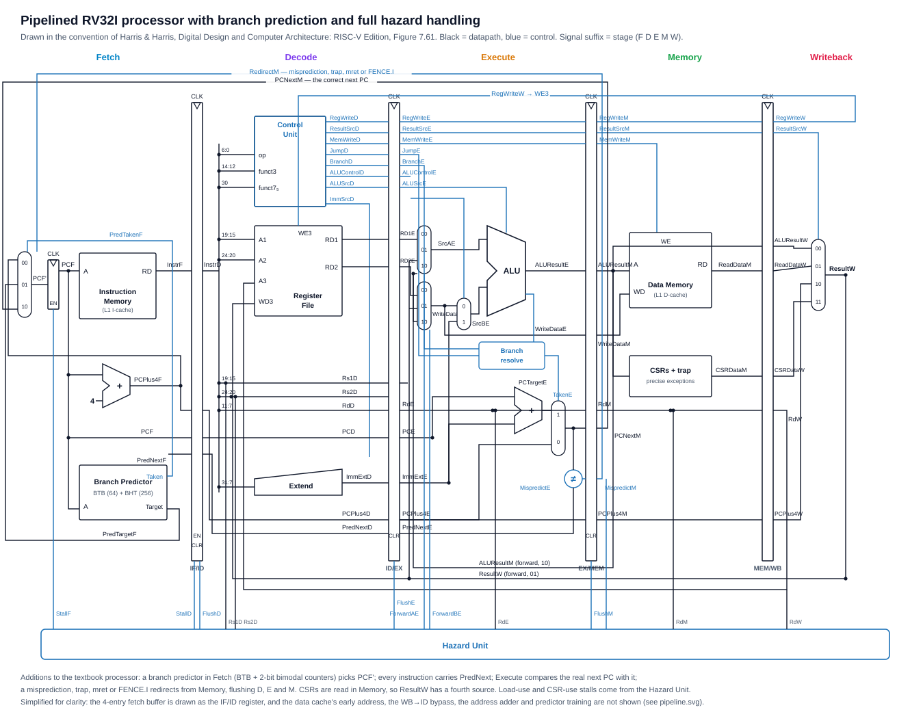
</p>

The second figure is the same pipeline at the level of this implementation — every forwarding
path, the decoupled fetch unit, the early data-cache address and the stall and flush paths:

<p align="center">
  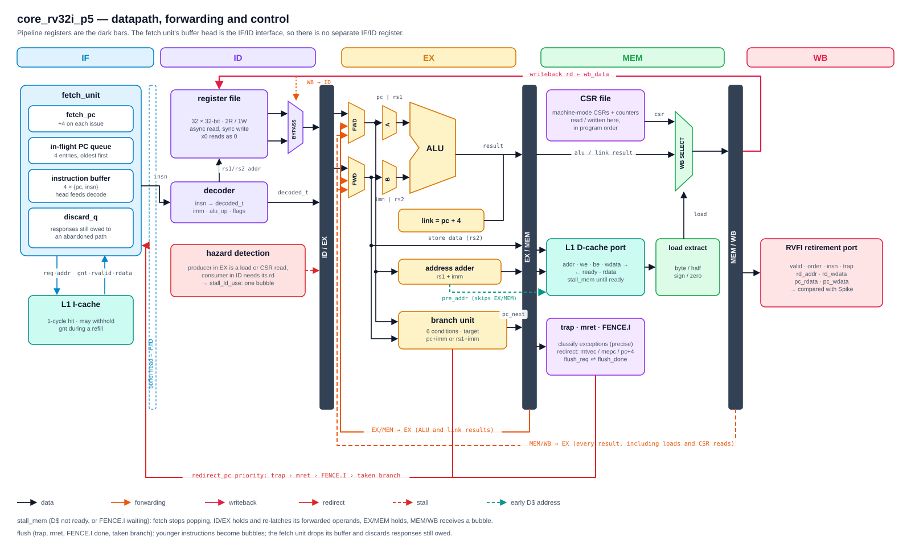
</p>

The core is a classic five-stage in-order pipeline with four departures that matter: the
**front end is decoupled** by a prefetch buffer, **branches are predicted in IF** by a branch
target buffer and bimodal predictor, **traps, CSR accesses and branch redirects happen in MEM**
rather than spread across stages, and the **data cache is read one cycle early** so that a hit
completes in MEM without a stall.

Each pipeline register is a SystemVerilog `struct` carrying `valid`, the PC, the raw
instruction and the decoded control bundle forward, so every later stage can see exactly what
instruction it holds — which is also what makes the RVFI trace at WB possible.

| Register | Carries |
|---|---|
| ID/EX | `valid, pc, insn, decoded_t, rs1_data, rs2_data, pred_next, pred_is_seq, pred_is_tgt` |
| EX/MEM | `valid, pc, insn, decoded_t, alu_result, rs1_data, store_data, mem_addr, pc_next, fetch_misaligned, mispredict, br_taken` |
| MEM/WB | `valid, pc, insn, rd_addr, rd_we, wb_data, pc_next, trap` |

### 4.1 IF — the decoupled fetch unit

<p align="center">
  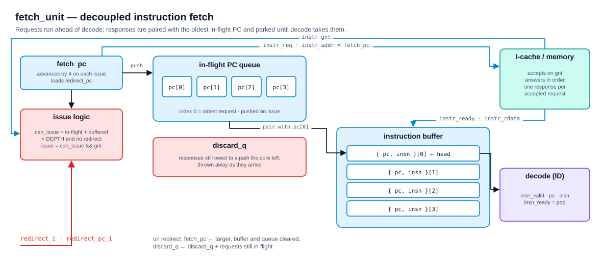
</p>

The first version of this pipeline fetched directly from memory, and a fetch stall froze the
whole pipeline. Measured with memory latency, that made the pipeline **29% slower than the
single-cycle core at every latency**: fetch latency was paid once per instruction, exactly as
on the single-cycle machine, so the pipeline's overlapping stages bought nothing. The fetch
unit fixes that by decoupling fetch from decode.

**How it works:**

- **`fetch_pc`** runs ahead of decode. A request is presented whenever there is room for its
  response: *in-flight requests + buffered instructions < DEPTH (4)* and no redirect this cycle.
  The request is **issued** — its PC queued, `fetch_pc` advanced — only when the memory
  grants it (`instr_req && instr_gnt`). The I-cache withholds the grant while it refills a line.
- **Where `fetch_pc` goes next** is decided by the branch predictor, looked up at the PC being
  requested: the predicted target if it predicts a taken branch or jump, otherwise `pc + 4`
  ([4.8](#48-branch-prediction)). That predicted next PC is stored with the request and
  travels with the instruction, so EX can check it.
- **The in-flight PC queue** remembers the PC of every issued request, oldest first. Memory
  answers in order, so each response is paired with the oldest queued PC.
- **The instruction buffer** holds up to four `{pc, insn}` pairs waiting for decode. Its head
  *is* the IF/ID interface: `insn_valid` is simply "the buffer is not empty". When the buffer is
  empty a bubble flows down the pipeline instead of the pipeline freezing.
- **Redirects** (branch misprediction, trap, `mret`, `FENCE.I`) load the new PC, clear the buffer and the
  queue, and add every still-unanswered request to **`discard_q`**. Responses that arrive for
  the abandoned path are counted down and dropped, so a wrong-path instruction can never reach
  decode. The counter *accumulates* across redirects: two redirects in consecutive cycles (a
  taken branch to a misaligned target, then that branch's trap) must discard the owed responses
  of both.

A subtle ordering detail: a response and a new request can happen in the same cycle. The
response shifts the queue down, so the new PC is written at its *post-shift* index — writing it
first loses an entry. A simulation assertion checks the occupancy invariant every cycle.

### 4.2 ID — decode, register read, hazard detection

**Decoder** (`decoder.sv`). Purely combinational; turns the 32-bit instruction into a
`decoded_t` bundle:

| Field | Meaning |
|---|---|
| `rs1_addr, rs2_addr, rd_addr, rd_we` | register operands and whether `rd` is written |
| `imm` | the sign-extended immediate for this format (I, S, B, U, J, or the CSR address) |
| `alu_op, alu_a_pc, alu_b_imm` | ALU operation and operand-mux selects |
| `is_branch, is_jal, is_jalr, is_load, is_store, is_csr` | instruction class |
| `is_ecall, is_ebreak, is_mret, is_fence_i, illegal` | system instructions and illegal encodings |
| `funct3` | carried for branch conditions, load/store size, CSR operation |

RISC-V keeps `rs1`, `rs2` and `rd` at fixed bit positions in every format, so the register file
starts reading before decode finishes. The price is the scrambled B- and J-type immediates,
which the decoder reassembles.

**Register file** (`regfile.sv`). 32 × 32 bits, two asynchronous read ports, one synchronous
write port, reset to zero, `x0` hard-wired to zero on read and never written.

**WB → ID bypass.** The register file writes on the clock edge but reads asynchronously, so an
instruction in ID would read the *old* value of a register being written by the instruction in
WB that same cycle. A small mux forwards the WB value instead.

**Hazard detection.** One hazard cannot be solved by forwarding: when the instruction in EX
produces its value only at the end of **MEM** — a **load**, or a **CSR read** (CSRs are
accessed in MEM) — and the instruction in ID needs that value. Detection raises
`stall_ld_use`: the ID instruction stays put and a bubble enters EX. One cycle later the
producer is in MEM/WB and ordinary forwarding delivers the value.

### 4.3 EX — forwarding, ALU, branches, addresses

**Forwarding.** Each source operand passes through a forwarding mux with three inputs, in
priority order:

1. **EX/MEM** — the result of the instruction one ahead, if it writes `rd`, `rd ≠ x0`, and its
   result actually exists in EX. Loads and CSR reads are excluded: in EX/MEM their
   `alu_result` is an address or meaningless, and forwarding it would hand the consumer garbage
   (they are covered by the interlock above).
2. **MEM/WB** — the final writeback value of the instruction two ahead, including loaded data
   and CSR read data.
3. The value read in ID.

**ALU** (`alu.sv`). Combinational, eleven operations: `ADD SUB SLL SLT SLTU XOR SRL SRA OR AND`
and `PASS_B` (for `LUI`). Shift amounts use `b[4:0]`. Operand A is `rs1` or the PC (`AUIPC`);
operand B is `rs2` or the immediate.

**Link address.** `JAL`/`JALR` write `pc + 4`, computed **here** rather than later so the very
next instruction can forward it (a `call` followed immediately by a use of `ra` does not stall).

**Branch unit.** Evaluates the six conditions (`== ≠ <s ≥s <u ≥u`) on the forwarded operands
and computes the target: `pc + imm` for branches and `JAL`, `(rs1 + imm) & ~1` for `JALR`. It
then **checks the prediction**: if the real next PC differs from the PC fetch already went to,
the instruction is marked `mispredict` in EX/MEM and the redirect fires from MEM
([4.8](#48-branch-prediction)). A target that is not 4-byte aligned is recorded as
`fetch_misaligned` — the only exception that has to be detected in EX, because it depends on
the branch decision.

**Address adder.** `mem_addr = rs1 + imm`. This value goes two places: into EX/MEM as usual,
and — **bypassing EX/MEM** — to the data cache as `data_pre_addr`, so the cache can read its
arrays on the same clock edge the instruction enters MEM (see [5.4](#54-the-data-cache)).

### 4.4 MEM — data access, CSRs, the trap point

**Data access.** Stores replicate their data across the word (`{4{byte}}`, `{2{half}}`) and
drive per-byte enables (`0001 << addr[1:0]`, `0011`/`1100`, `1111`); the memory writes only the
enabled lanes. Loads receive the whole aligned word and extract the byte or halfword lane,
sign- or zero-extending it. While the data cache is not ready, `stall_mem` holds the pipeline.

**CSR access** happens here, in program order. The operand is `rs1` (or the zero-extended
5-bit immediate for the `…I` forms); the new value is computed (`W`: replace, `S`: set bits,
`C`: clear bits) and the old value becomes the writeback value. `CSRRS`/`CSRRC` with
`rs1 = x0` read without writing.

**Exception classification** also happens here, from fields already registered in EX/MEM
(this used to sit at the end of the longest path in EX, and moving it here shortened that
path). The trapping instruction:

- has written nothing architectural yet (a trapping store never reaches memory);
- has every older instruction already retired;
- has every younger instruction still in IF/ID/EX, where it is simply flushed.

That is what makes exceptions **precise** with no extra recovery hardware.

**`MRET`** redirects to `mepc`. **`FENCE.I`** holds in MEM until both caches report done, then
redirects to `pc + 4` ([5.6](#56-fencei-end-to-end)). A **branch misprediction** found in EX
redirects from here to the real next PC, and the branch predictor is **trained** from here.

**Writeback select** chooses the loaded value, the CSR value, or the ALU/link result.

### 4.5 WB — writeback and retirement

The MEM/WB register writes `rd` (suppressed for `x0` and for trapping instructions) and drives
the **RVFI retirement port**: `valid, order, insn, trap, rd_addr, rd_wdata, pc_rdata, pc_wdata`.
`rd_wdata` reads zero whenever `rd = x0` — `ret` computes a link address only to throw it away,
and reporting that value would diverge from every reference model.

### 4.6 Hazards, stalls and flushes

<p align="center">
  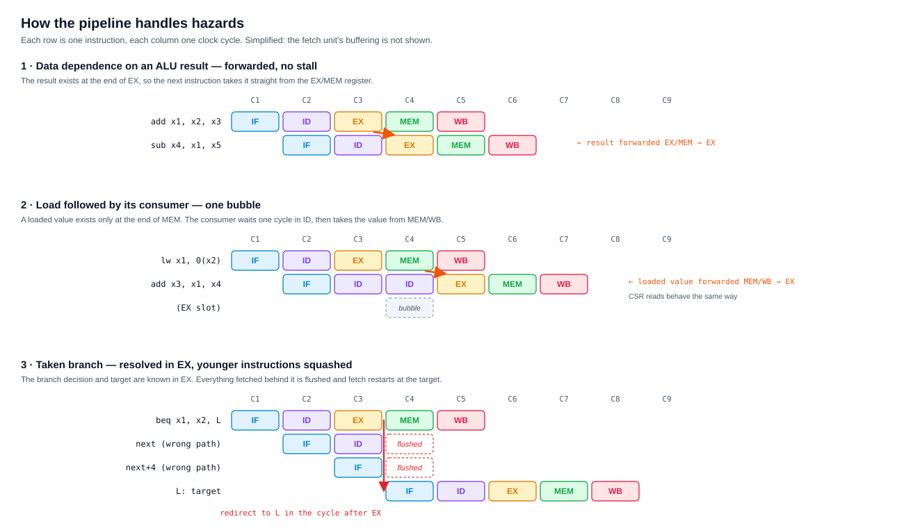
</p>

| Situation | Detected in | Cost | Mechanism |
|---|---|---|---|
| ALU result needed by the next instruction | EX | 0 | EX/MEM → EX forward |
| Any result needed two instructions later | EX | 0 | MEM/WB → EX forward |
| Value written by WB needed in ID the same cycle | ID | 0 | WB → ID bypass |
| Load or CSR read followed by its consumer | ID | 1 cycle | `stall_ld_use`: hold ID, bubble into EX |
| Correctly predicted branch or jump | IF | 0 | fetch already followed the prediction |
| Mispredicted branch or jump | EX, redirected from MEM | the three younger instructions | `flush_trap` + fetch redirect |
| Trap, `MRET`, `FENCE.I` completion | MEM | everything younger | `flush_trap` + fetch redirect |
| Data cache miss / `FENCE.I` waiting | MEM | until ready | `stall_mem` |
| Instruction not yet fetched | IF | absorbed | buffer empty → bubble, no freeze |

**`stall_mem` in detail.** While MEM waits, the fetch unit stops handing out instructions,
ID/EX and EX/MEM hold, and MEM/WB receives a bubble (nothing retires twice). One detail here
was a real bug found by the verification flow: the instruction held in EX may have been taking
an operand from MEM/WB, and MEM/WB empties on the first stall cycle. The held operands
therefore **re-latch their forwarded values every stall cycle**, capturing whatever was being
forwarded before its source leaves the pipeline.

**Priority.** All redirects are decided in MEM, by the instruction there, in the order
trap › `mret` › `FENCE.I` › branch misprediction. A branch whose target is misaligned traps
instead of redirecting.

### 4.7 Traps and the CSR file

On a trap, `csr_file` records `mepc ← pc`, `mcause`, `mtval`, pushes `MIE` into `MPIE` and
clears `MIE`; the core redirects to `mtvec`. `MRET` pops `MPIE` back into `MIE` and returns to
`mepc`.

Two implementation points are worth knowing:

- **Write intent vs. commit.** The core drives the CSR write enable as pure *intent* (“this is
  a CSR instruction that writes”). Legality (`illegal_o`) is computed from that intent. The
  actual register update is gated inside `csr_file` by `stall_i`. Gating the write enable in
  the core instead creates a combinational loop — *write enable → legality → trap → stall →
  write enable* — which an earlier version had, and which made every timing number measured
  on it meaningless. Synthesis now refuses to report timing for any design with a loop.
- **`minstret` counts an instruction as it leaves MEM**, the same stage where CSRs are read and
  written. Counting at WB made a counter read one instruction behind and let a counter write
  cancel the wrong increment.

### 4.8 Branch prediction

Without prediction, fetch always continues at `pc + 4`, so every taken branch and every jump
throws away the instructions fetched behind it. Loops pay that on every iteration. The
predictor lets fetch follow a taken branch **before the branch is even decoded**.

**Structures** (`branch_predictor.sv`, looked up at the fetch PC):

| Structure | Size | Indexed by | Holds |
|---|---|---|---|
| Branch target buffer (BTB) | 64 entries, direct-mapped | `pc[7:2]` | valid, tag `pc[31:8]`, target, and whether the entry is a conditional branch or a jump |
| Bimodal branch history table (BHT) | 256 × 2-bit counters | `pc[9:2]` | `00` strongly not-taken · `01` weakly not-taken · `10` weakly taken · `11` strongly taken |

**Predicting.** A BTB hit means "the instruction at this PC is a branch or jump we have seen
taken". A jump is predicted taken; a conditional branch is predicted taken when its counter is
`10` or `11`. On a predicted-taken hit the fetch unit's next request goes to the BTB target;
otherwise to `pc + 4`. Counters start at `01`, so an unseen branch is predicted not-taken.

**Checking.** Every instruction — not just branches — carries `pred_next`, the PC fetch went
to after it. The real next PC is known in EX, and any difference is a misprediction: a wrong
direction, a wrong target (a `JALR` returning to a different caller), or a stale BTB entry on an
instruction that is not a branch at all. One rule covers every case, so a prediction can only
ever cost cycles, never correctness. To keep this off EX's critical path, ID already compares
`pred_next` with the two candidates that do not depend on registers, `pc + 4` and `pc + imm`;
EX picks one bit with the branch outcome, and only `JALR` compares a full target in EX.

**Recovering.** A misprediction is recorded in EX/MEM and the redirect fires from MEM, through
the same flush path as a trap. The three younger instructions are discarded and fetch restarts
at the real next PC. A correctly predicted branch — taken or not — costs nothing.

**Training.** Once per resolved branch or jump, from MEM: a conditional branch moves its
counter one step toward the outcome (saturating), and any taken branch or jump writes its target
into the BTB. A loop branch therefore mispredicts once at loop exit, and stays predicted taken
when the loop is entered again, because one not-taken outcome only weakens a strongly-taken
counter.

**Why the redirect and training happen in MEM.** The first version redirected straight from EX,
saving one cycle per misprediction. Synthesis showed it cost a third of the clock rate: the
32-bit "next PC ≠ prediction" compare sat behind the forwarding muxes and branch adder, on a
path into the fetch unit (175 MHz). Redirecting from MEM, keeping the BTB arrays out of
flip-flops, training from MEM and moving the compares into ID brought the pipeline to
**264.4 MHz** — faster than it was without prediction (259.0 MHz). The measurements for each step
are in `results/experiments.md` §7.

| Program (pipeline, ideal memory) | Cycles before → after | IPC | Accuracy |
|---|---|---|---|
| `hello.c` (296 instructions) | 484 → **381** (1.27×) | 0.61 → 0.78 | 78% (21 misses in 96) — too short to train |
| `cachestress.c` (32,091 instructions) | — → **32,700** | 0.98 | **99.4%** (24 misses in 3,930) |

---

## 5. The memory hierarchy

The cached system puts a split L1 between the pipeline and a slow main memory:

```
core ──instr──▶ icache ─┐
                         ├──▶ mem_arbiter ──line port (16 bytes)──▶ main memory
core ──data───▶ dcache ─┘
```

### 5.1 Cache organisation

<p align="center">
  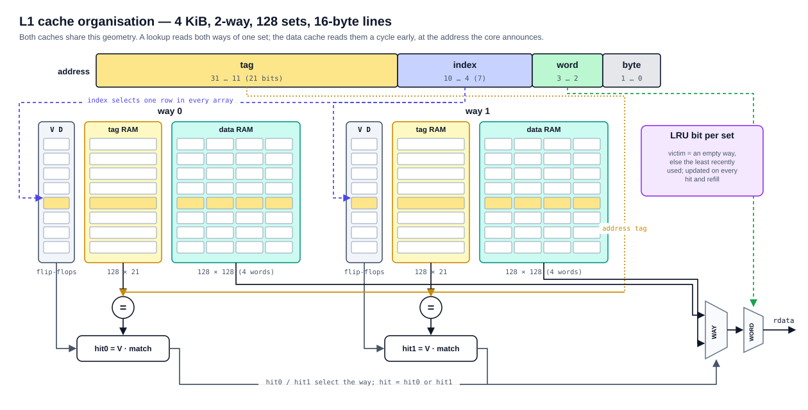
</p>

Both caches use the same geometry:

| Parameter | Value |
|---|---|
| Capacity | 4 KiB each |
| Line size | 16 bytes (4 words) |
| Associativity | 2-way |
| Sets | 128 (each way spans 2 KiB of address space) |
| Address split | tag `[31:11]` (21 bits) · index `[10:4]` (7 bits) · word `[3:2]` · byte `[1:0]` |
| Replacement | 1 LRU bit per set; an empty way is used first |
| Tag and data arrays | synchronous-read block RAM, one tag RAM (128 × 21) and one data RAM (128 × 128) per way |
| Valid / dirty / LRU bits | flip-flops |
| Blocking | one miss at a time |

A lookup reads both ways of the indexed set, compares both stored tags with the address tag,
and qualifies each match with that way's valid bit. The hitting way's 128-bit line goes through
a way mux, then a word select picks the 32-bit word.

**Why the valid, dirty and LRU bits are flip-flops, not RAM:** reset must clear them, and
`FENCE.I` must clear every valid bit in the instruction cache in one cycle. Block RAM can do
neither.

### 5.2 The block-RAM template

`sram_1r1w` is a simple dual-port RAM — one synchronous read port and one write port with
independently enabled lanes — written in the exact form Vivado maps to block RAM
(`ram_style = "block"`). All eight cache arrays are instances of it; synthesis confirms ten
block-RAM tiles.

Two ports are required, not one. A store hit writes its line at the end of MEM on the same
clock edge that the *next* access reads its set, and a single-port RAM cannot do both.

A same-address read during a write returns the **old** data in this model. Real block RAM's
behaviour depends on its configured mode, so the caches never depend on it: they detect the
collision and read again.

### 5.3 The instruction cache

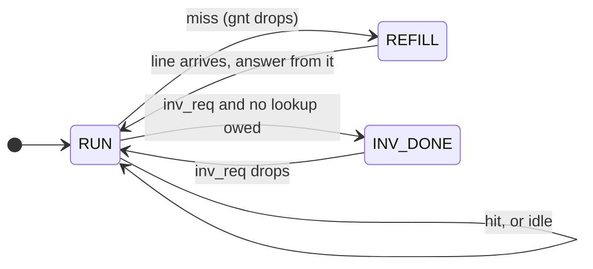

- **Protocol.** A request is accepted on `req && gnt`. Exactly one response (`rvalid`) comes
  back per accepted request, in order — the fetch unit relies on that pairing.
- **Hit.** The arrays are read at the request address on the accept edge; the next cycle the
  tags are compared and the instruction is returned. A new request can be accepted in that
  same cycle, so hits stream at **one instruction per cycle**.
- **Miss.** `gnt` drops, the line is fetched over the line port, written into the victim way,
  and the instruction is answered directly from the returned line.
- **Redirects never abort a refill.** The fetch unit's discard counter drops the response
  instead, which is far simpler than cancelling a transfer half-way.
- **`FENCE.I`** clears every valid bit at once, but only after any owed response or in-flight
  refill has completed.

### 5.4 The data cache

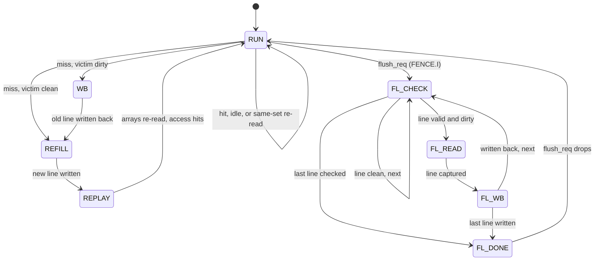

**One-cycle hits from a synchronous RAM.** A block RAM returns data the cycle *after* it is
given an address. To finish a hit inside MEM, the cache must already have read the right set
when the instruction arrives — so the core sends the address of the access that will be in MEM
**next** cycle, `data_pre_addr`, straight from the EX address adder. While MEM is stalled the
core repeats the held address instead, so the arrays keep presenting the right set. This is a
contract between the core and the cache, and breaking it would corrupt data silently, so a
**simulation assertion** checks on every lookup that the arrays were read at the set being
looked up.

**Hit.** A load returns the whole aligned word (the core extracts bytes). A store writes its
enabled byte lanes into the hitting way and sets that line's dirty bit. Both take one cycle,
with no stall.

**Miss.** The victim is an empty way if there is one, otherwise the LRU way. If the victim is
valid and dirty it is written back first (`WB`), then the new line is fetched (`REFILL`). The
final `REPLAY` cycle re-reads the arrays, so the original access then completes **through the
normal hit path** — load and store hits are handled in exactly one place.

**The same-set collision.** A store hit writes set *S* on the same clock edge that reads the
set for the next access. If that is also *S*, the read returns stale data. The cache detects
the case and holds the next access one cycle to read again. The data-cache testbench proves this
guard is necessary: with it disabled, the directed store-then-load tests fail.

**Flush.** `FENCE.I` walks all 256 lines (128 sets × 2 ways), writes back each valid dirty line
and clears its dirty bit; lines stay valid.

**Statistics.** Hit and miss pulses are exported for measurement. A miss's eventual completion
is not counted as a hit, so `hits / (hits + misses)` is a true hit rate.

### 5.5 Arbiter, line port and main memory

**The line port.** Every cache-to-memory link uses one simple protocol: the requester drives
`req, we, addr[31:4], wdata[127:0]` and holds them steady until the responder raises `ready`
for one cycle with `rdata[127:0]`. A whole 16-byte line moves per transaction. An AXI bridge or
an L2 cache would attach to exactly this interface.

**`mem_arbiter`** shares one port between the two caches. An idle arbiter adds no latency; the
**data side wins a tie**, because a pending data access stalls the whole pipeline while the
fetch buffer can ride out a short delay; and a granted side keeps the port until its transfer
finishes, so a write-back and a refill are never interleaved.

**`main_mem`** (simulation only) serves lines after `LATENCY` wait states — an access takes
`LATENCY + 1` cycles, and 0 answers in the same cycle. It stores 32-bit words so ordinary
program hex files load directly, and a write commits only on its `ready` cycle.

### 5.6 FENCE.I, end to end

`FENCE.I` guarantees that instructions written by stores are the ones executed afterwards.
With separate caches that needs both caches and the pipeline to cooperate, in a fixed order:

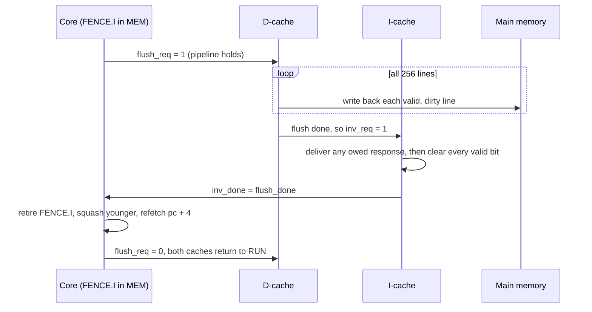

The order matters. The instruction cache is invalidated only *after* the data cache has written
everything back, so any line it refills afterwards comes from up-to-date memory. Instructions
prefetched before the fence may be stale, so the core discards them and refetches from
`pc + 4`. The official `rv32ui-p-fence_i` test, which writes instructions and then executes
them, passes through the caches.

---

## 6. The single-cycle baseline

`core_rv32i` executes every instruction in one clock period: fetch, decode, register read, ALU,
memory access, CSR access and writeback all sit in one combinational path between two clock
edges. It uses the same decoder, ALU, register file and CSR file as the pipeline, supports the
same ISA and traps, and emits the same RVFI trace. With ideal memory its IPC is exactly 1.0.

It exists as the reference point. Its synthesised Fmax (216.7 MHz) is **optimistic** for a real
single-cycle machine, because memory is outside the synthesised design: a real single-cycle CPU
must fit an instruction fetch *and* a data access inside its clock period.

---

## 7. The verification ecosystem

<p align="center">
  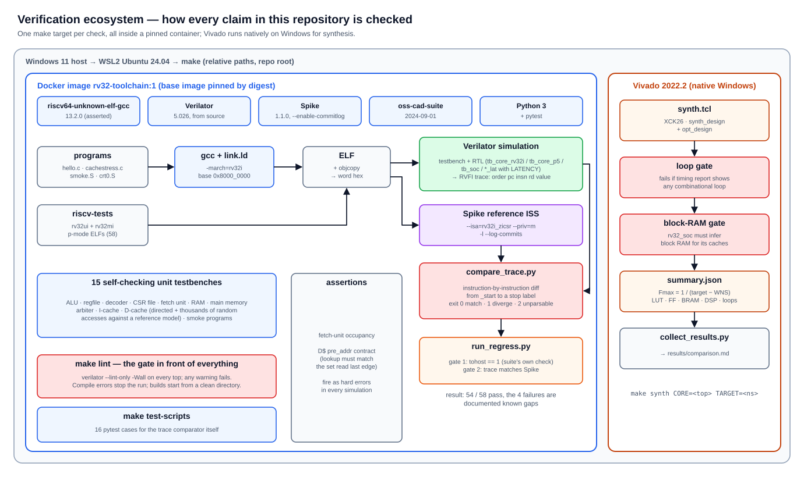
</p>

Everything in this README is backed by a check that can be re-run with one `make` command.

### 7.1 A pinned, reproducible toolchain

All simulation and compilation runs inside one Docker image, built from `docker/Dockerfile`:

| Tool | Version | How it is pinned |
|---|---|---|
| Ubuntu base | 24.04 | by image **digest**, not tag (a tag is re-pointed at new releases) |
| `riscv64-unknown-elf-gcc` | 13.2.0 | from apt; `make tools-check` **fails** if the version drifts, because a different compiler changes instruction counts and invalidates comparisons |
| Verilator | 5.026 | built from source at a fixed tag |
| Spike | 1.1.0 | built from source **with `--enable-commitlog`**, without which Spike silently emits no trace; `tools-check` probes for it |
| oss-cad-suite | 2024-09-01 | appended to `PATH` so its bundled Verilator cannot shadow the pinned one |
| Python 3 | Ubuntu 24.04 package | runs the comparison and regression scripts; `make test-scripts` installs pytest for the comparator's own tests |

Vivado 2022.2 runs natively on Windows for synthesis. The Makefile uses only relative paths
(the repository path contains a space, which GNU Make cannot escape in prerequisites).

### 7.2 Lockstep comparison against Spike

The core of the flow: run the same program on the RTL and on **Spike**, the official RISC-V
reference simulator, and compare them **one retired instruction at a time**.

1. `gcc -march=rv32i` compiles the program with `crt0.S` and `link.ld` (base `0x8000_0000`,
   Spike's default memory base; `tohost` at `0x8001_0000`). `crt0.S` zeroes every register so
   both sides start from identical state.
2. The ELF becomes a word-per-line hex image for the simulated memory.
3. **Spike** runs the ELF with `--isa=rv32i_zicsr --priv=m -l --log-commits` and writes a
   commit log: PC, instruction, destination register and value for every instruction.
4. **Verilator** simulates the testbench + RTL; the testbench writes one line per RVFI
   retirement: `order pc insn rd value`.
5. **`scripts/compare_trace.py`** diffs the two from `_start` to a labelled stop point and
   reports the first divergence with both sides' records.

Details the comparator gets right:

- **Trapping instructions** appear in neither trace (Spike's commit log omits them), so the
  testbench skips them too. This does not weaken trap checking: a missing or extra trap shifts
  every later record and is reported at once.
- **The stop point.** The RTL testbench stops when the `tohost` store completes, but Spike runs
  on until its host interface notices. Both traces are compared up to the same labelled
  instruction (`_finish_loop`, or `write_tohost` in riscv-tests) rather than truncated to equal
  length, which would hide a hung core.
- **Exit codes**: `0` match, `1` divergence (including a trace that ends early on either side),
  `2` a line that looks like a record but cannot be parsed — a silently skipped line would shift
  every later index and blame the wrong instruction.
- **Completion on the handshake.** Testbenches end on the `tohost` store's *handshake*, not its
  request: behind a cache or slow memory the request is visible for many cycles before the store
  completes, and ending early cuts the trace short.
- The comparator has **16 pytest cases of its own** (`make test-scripts`).

### 7.3 The compliance regression

`make regress` runs the official **riscv-tests** suite (`rv32ui` user-level and `rv32mi`
machine-level tests, p-mode, 58 tests) through `scripts/run_regress.py`. Every test must pass
**two independent gates**:

1. **The suite's own check**: the test writes `1` to `tohost` on success, or the failing
   sub-test number on failure.
2. **The trace check**: the RTL trace matches Spike up to `write_tohost`.

Spike's log is deleted before each run and must be freshly written, so a failed Spike
invocation can never be compared against a stale log.

**Result: 54/58 on every design.** The pipeline was also regressed at 1, 2 and 4 wait states and
the cached system at 1, 4 and 10, with the same result. The four failures are documented and
listed in the script, so any new failure is reported as unexpected:

| Test | Why it does not pass |
|---|---|
| `rv32ui-p-ma_data` | requires hardware support for misaligned loads/stores; this core traps instead, which the specification permits |
| `rv32mi-p-breakpoint` | needs the debug trigger module (`tselect`, `tdata*`), not implemented |
| `rv32mi-p-mcsr` | passes its own check; differs only in `marchid`, an implementation-defined identity value |
| `rv32mi-p-pmpaddr` | needs implemented PMP regions; zero are implemented |

### 7.4 Unit testbenches

Sixteen self-checking testbenches, each printing `PASS` or failing with a precise message:

| Testbench | What it proves |
|---|---|
| `tb_rv32_pkg` | every ISA constant and encoding in the package |
| `tb_alu` | every ALU operation, including shift masking and signed compares |
| `tb_regfile` | two reads, one write, `x0` behaviour |
| `tb_decoder` | every instruction format, immediate reassembly, illegal encodings, `FENCE.I` |
| `tb_csr_file` | CSR reads/writes, legality, trap entry/`mret`, counters, stall gating |
| `tb_magic_mem`, `tb_latency_mem` | the memory models' latency and byte enables |
| `tb_fetch_unit` | prefetching, back-pressure (random grant refusal), redirects in flight, back-to-back redirects, following a predicted-taken branch |
| `tb_branch_predictor` | cold misses, jumps always taken, every 2-bit counter transition including saturation at both ends, target updates, tag aliasing, reset |
| `tb_sram_1r1w` | read latency, lane-masked writes, the documented collision behaviour |
| `tb_main_mem` | exact wait-state latency at 0/1/4, line layout, write-once commit |
| `tb_mem_arbiter` | tie-breaking, no lost or duplicated transfers, no interleaving |
| `tb_icache` | one response per accepted request in order, LRU choice, invalidation during a lookup and during a refill, 4,000+ random fetches |
| `tb_dcache` | dirty eviction, LRU choice, same-set collision, true hit counting, flush; 6,000 random loads/stores of every size checked against a reference memory, and main memory compared word for word after every flush |
| `tb_core_rv32i_smoke`, `tb_core_p5_smoke` | a short program on each core, checked register by register |

Several tests were also proven **load-bearing** by deliberately breaking the RTL and confirming
the test fails — for example, the cache LRU update and the data cache's collision guard.

### 7.5 Programs

| Program | Purpose |
|---|---|
| `verif/prog/hello.c` | small mixed workload: arithmetic, arrays, loops, multiply/divide via libgcc |
| `verif/prog/cachestress.c` | defeats the data cache on purpose: three arrays aligned to one cache way contend for two ways (conflict misses and dirty evictions), then an 8 KiB stream (capacity misses), then byte and halfword stores into cached lines; 32,000+ instructions |
| `verif/prog/smoke.S` | the hand-checked program used by the smoke testbenches |
| `verif/prog/crt0.S`, `link.ld` | startup code and memory map shared by all programs |

### 7.6 Build safeguards

- **`make lint` gates everything.** Verilator `--lint-only -Wall` runs on every top-level module,
  and any warning fails the build. Warnings are fixed at their cause, never waived with pragmas.
  Every simulation target depends on it.
- **Compile failures stop the run, and builds start clean.** Simulation object directories are
  deleted before every build, so a stale binary can never run and report a result for code that
  no longer compiles.
- **Simulation assertions** run in every simulation: the fetch-unit occupancy invariant and the
  data-cache early-address contract.
- **Synthesis gates** (`scripts/synth.tcl`): the run **fails** if Vivado's timing report shows any
  combinational loop, and the cached system **fails** if its arrays were not inferred as block
  RAM. Fmax is computed as `1 / (target period − worst negative slack)`.
- `scripts/collect_results.py` regenerates `results/comparison.md` from the recorded JSON, so
  the published numbers always come from tool output.

---

## 8. Results

All numbers come from `results/raw/*.json` and `results/experiments.md`. FPGA figures are
**post-synthesis estimates** for `xck26-sfvc784-2LV-c`; nothing has been placed and routed yet.

### FPGA implementation

<p align="center">
  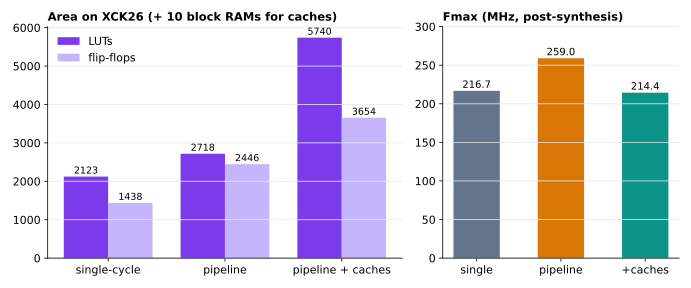
</p>

| Design | Fmax | LUTs | Flip-flops | Block RAM | DSP | Share of XCK26 LUTs |
|---|---|---|---|---|---|---|
| Single-cycle core | 216.7 MHz | 2,123 | 1,438 | 0 | 0 | 1.8% |
| Pipeline + branch prediction | 264.4 MHz | 4,110 | 3,401 | 0 | 0 | 3.5% |
| **Pipeline + prediction + L1 caches** | **213.5 MHz** | **6,788** | **4,604** | **10** | **0** | **5.8%** |

The cached system's critical path runs from a data-cache tag RAM, through the tag compare and
hit logic, to the write enable of a data-cache data RAM — the store-hit path.

### Performance under memory latency

<p align="center">
  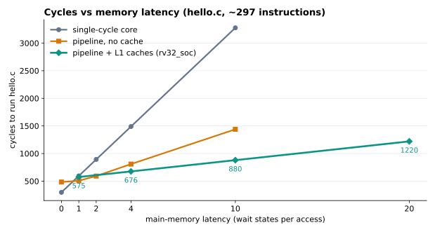
</p>

Cycles to run `hello.c` (about 297 instructions):

| Wait states | Single-cycle | Pipeline + prediction, no cache | Pipeline + prediction + caches |
|---|---|---|---|
| 0 | 297 | 381 | — |
| 1 | 595 | 404 | 471 |
| 4 | 1,489 | 637 | 575 |
| 10 | 3,277 | 1,201 | **785** |
| 20 | — | — | 1,135 |

At 10 wait states the cached system needs **4.2× fewer cycles than the single-cycle core** and
**1.53× fewer than the uncached pipeline**. With ideal memory (0 wait states) the single-cycle
core is fastest in cycles — ideal memory is the one case a pipeline cannot win, which is why
every comparison here is made under realistic latency.

**Cache stress test** (`cachestress.c`, 32,092 instructions) at 10 wait states:

| | Uncached pipeline | Pipeline + caches |
|---|---|---|
| Cycles | 133,588 | 114,830 (**1.16× fewer**) |
| IPC | 0.240 | 0.279 |
| I-cache hit rate | — | 99.9% (32,142 / 32,180) |
| D-cache hit rate | — | 36.5% (2,580 / 7,073), by design of the test |

On `hello.c`, hit rates are 91.5% (instruction) and 82.6% (data). Branch prediction removed
the same 11,649 cycles from the cached stress test at every latency — it removes branch
penalties, not memory stalls (`results/experiments.md` §7).

**Honest caveats.**

- At **1 wait state the caches are slower** on both programs: 471 vs 404 cycles on `hello.c`,
  and 55,621 vs 39,773 on `cachestress.c`. The cause was not measured; refilling a whole 16-byte
  line on every miss is the likely explanation.
- **Wall-clock time** must also account for the clock: the caches lower Fmax from 264.4 to
  213.5 MHz. At 10 wait states that leaves `hello.c` about 1.2× faster in real time, but the stress
  test about **6% slower** (538 µs vs 505 µs) — its data-cache hit rate is too low to pay for
  the slower clock. Shortening the data cache's store-hit path is the fix.
- **No standard benchmark yet.** CoreMark and Dhrystone have not been run, so this design cannot
  yet be ranked against published cores.

---

## 9. Design decisions and trade-offs

| Decision | Why | Cost |
|---|---|---|
| **Predict in IF (BTB + bimodal), check in EX, redirect and train from MEM** | Fetch follows a taken branch before it is decoded, so correctly predicted branches cost nothing. Redirecting from EX was measured and cost a third of the clock rate; from MEM the pipeline is faster than without prediction. An earlier ID-stage static predictor was reverted (`results/experiments.md` §3) | A misprediction squashes three instructions instead of two; one extra cycle before the predictor learns a branch |
| **Traps and CSRs at MEM** | Exceptions are precise for free; CSR instructions need no hazard logic because they access the file in order at one stage | CSR reads interlock like loads |
| **Decoupled fetch with a prefetch buffer** | Lets fetch latency overlap with execution; without it the pipeline lost to the single-cycle core under latency | One extra cycle before decode with ideal memory |
| **Exception classification in MEM** | Its priority mux and 32-bit `mtval` select were at the end of the longest EX path | None — every input is already registered |
| **Synchronous-read block-RAM caches + early address** | Real FPGA memories; one-cycle hits without an extra stage | The early-address contract between core and cache (guarded by an assertion) and a longer path into the RAM address |
| **Write-back, write-allocate data cache** | Stores stay in the cache; memory traffic only on eviction | Dirty bits, write-back on eviction, a flush walk for `FENCE.I` |
| **Blocking caches** | Simple, easy to verify; the foundation for later additions | No hit-under-miss |
| **Re-read on a same-set collision instead of bypassing** | Avoids depending on block-RAM collision modes and avoids a bypass network | One cycle on a rare case |
| **Refills are never aborted** | The fetch unit already discards stale responses | A redirected miss still pays for its line |
| **RVFI trace + Spike comparison** | Independent of microarchitecture; finds the first wrong instruction, not just a failed test | Spike omits trapping instructions, which the testbenches mirror |

---

## 10. Bugs the verification flow caught

These were real defects in this design, each invisible to at least one weaker form of testing:

| Bug | Why it hid | What exposed it |
|---|---|---|
| **Combinational loop** through the CSR write enable, legality, trap and stall | Simulation still passed; Vivado silently broke the loop for timing analysis | Making lint warnings fatal; Vivado's loop check is now a hard gate |
| **Stale binaries reporting MATCH** — a compile failure was masked and the previous executable ran | The output looked like success | A deliberate syntax error; the build now stops and rebuilds from clean |
| **Lost forwarding during memory stalls** — a held EX instruction fell back to a stale operand | Every earlier test used ideal memory, where nothing stalls | Running riscv-tests with one wait state: five store tests failed |
| **Fetch unit forgot owed responses** across back-to-back redirects | Needs a redirect in each of two consecutive cycles, with latency ≥ 2 | A targeted testbench case at latency 3 |
| **`minstret` off by one** after a counter write | Two back-to-back counter writes cancelled the error | An instruction-cache miss between them, in `rv32mi-p-instret_overflow` |
| **Cache hit statistics double-counted misses** | Did not affect correctness, only every hit rate | A directed one-load check in the cache testbench |

---

## 11. Limitations and roadmap

**Not implemented yet:** multiply/divide (M extension), compressed instructions, interrupts,
user/supervisor modes, an MMU, PMP enforcement, non-blocking caches. The
design has been synthesised but not placed, routed or run on the board. `minstret` still counts
instructions that trap (`ECALL`, `EBREAK`), which the privileged specification excludes.

**Planned next, each building on the current interfaces:**

- **2-wide superscalar issue**, building on the predicted fetch stream.
- **Return-address stack** for `JALR` returns, and a **gshare** predictor on the same BTB.
- **Shorter data-cache store-hit path**, to recover the clock rate the caches cost.
- **L2 cache** between the arbiter and main memory (the line port is designed for it).
- **Non-blocking data cache** with miss-status holding registers.
- **M extension**, then **custom instructions** in the reserved custom opcode space
  (`0x0B`, `0x2B`, `0x5B`, `0x7B`).
- **CoreMark** to compare against published cores.

---

## 12. Repository layout and make targets

```
rtl/
  common/   rv32_pkg.sv        ISA constants, decoded_t, ALU op encoding
            alu.sv             11-operation combinational ALU
            regfile.sv         32 x 32, 2R/1W, x0 = 0
            decoder.sv         instruction -> decoded_t, illegal detection
            csr_file.sv        machine-mode CSRs, counters, trap entry / mret
  core/     core_rv32i.sv      single-cycle core
            core_rv32i_p5.sv   five-stage pipeline
            fetch_unit.sv      decoupled fetch with prefetch buffer
            branch_predictor.sv  BTB + bimodal 2-bit counters
  mem/      sram_1r1w.sv       block-RAM template (synthesisable)
            icache.sv          L1 instruction cache
            dcache.sv          L1 data cache
            mem_arbiter.sv     two caches -> one line port
            main_mem.sv        line memory with wait states   (simulation only)
            latency_mem.sv     word memory with wait states   (simulation only)
            magic_mem.sv       zero-latency memory            (simulation only)
  soc/      rv32_soc.sv        pipeline + caches + arbiter
verif/
  tb/       16 unit/smoke testbenches + trace testbenches (tb_core_rv32i, tb_core_p5,
            tb_core_rv32i_lat, tb_core_p5_lat, tb_soc)
  prog/     crt0.S  link.ld  hello.c  cachestress.c  smoke.S
scripts/    compare_trace.py (+ tests)  run_regress.py  synth.tcl  collect_results.py
            make_diagrams.py  env_check.sh
docker/     Dockerfile (every tool version pinned)
results/    comparison.md  experiments.md  raw/*.json
docs/img/   the figures in this README (generated by scripts/make_diagrams.py)
```

| Target | What it does |
|---|---|
| `make env-check` | checks host prerequisites |
| `make docker-build` | builds the pinned toolchain image |
| `make tools-check` | verifies tool versions, GCC drift and Spike commit logging |
| `make lint` | Verilator `-Wall` on every top; fails on any warning |
| `make tb TB=<name>` | runs one unit testbench |
| `make cosim PROG=<prog> CORE_TB=<tb>` | compiles a program, runs it on RTL and Spike, compares traces |
| `make cosim-lat PROG=<prog> CORE_TB=<tb> LAT=<n>` | the same, with `n` memory wait states |
| `make fetch-tests` | clones riscv-tests |
| `make regress CORE_TB=<tb> [LAT=<n>]` | runs the compliance suite with both gates |
| `make test-scripts` | runs the comparator's own pytest suite |
| `make synth CORE=<top> TARGET=<ns>` | Vivado synthesis with the loop and block-RAM gates |
| `make results` | regenerates `results/comparison.md` |

---

## 13. References

- *Digital Design and Computer Architecture, RISC-V Edition* — Harris & Harris
- *Computer Organization and Design, RISC-V Edition* — Patterson & Hennessy
- *Computer Architecture: A Quantitative Approach* — Hennessy & Patterson
- [The RISC-V Instruction Set Manual (unprivileged and privileged)](https://riscv.org/technical/specifications/)
- [Spike, the RISC-V ISA simulator](https://github.com/riscv-software-src/riscv-isa-sim)
- [riscv-tests](https://github.com/riscv-software-src/riscv-tests)
- [RVFI — the RISC-V Formal Interface](https://yosyshq.readthedocs.io/projects/riscv-formal/en/latest/rvfi.html)
- [Verilator](https://www.veripool.org/verilator/)
